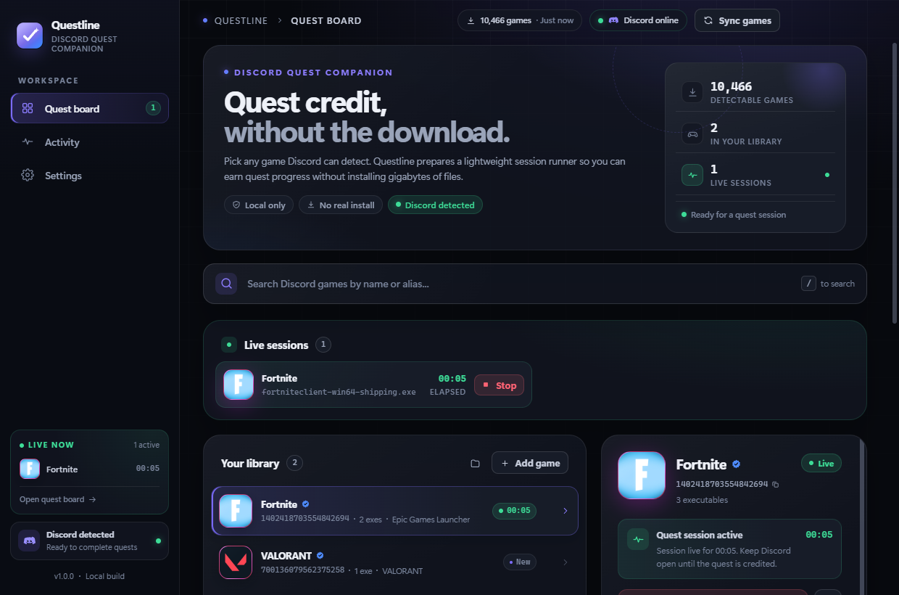
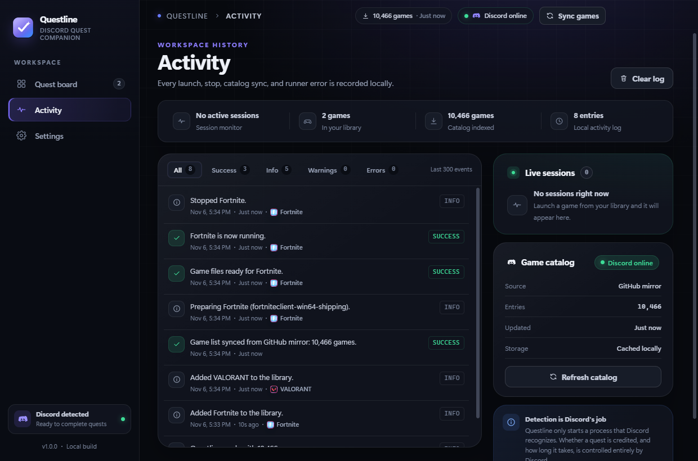
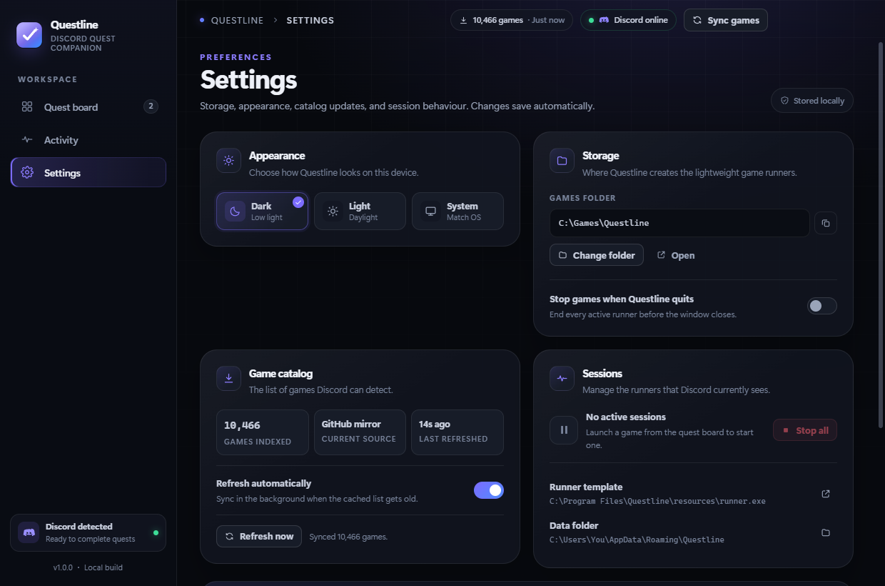
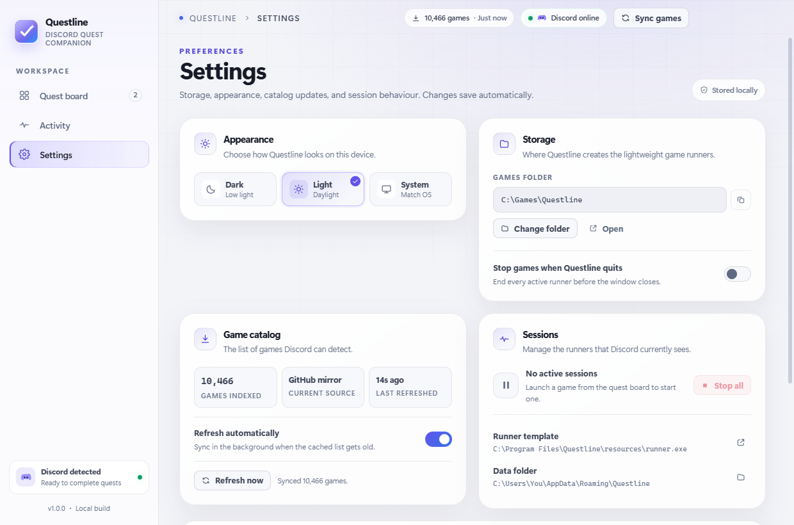

# Questline

**A local-first desktop companion for earning Discord quest progress without installing the full game.**

Questline lets you search Discord's detectable-game catalog, build a small library of titles, and launch a lightweight session runner for any of them. The runner uses the game's real executable name, so Discord's own game detection can see the activity while the quest timer runs. No gigabytes of game files, no account login, and no Discord tokens.

Questline is an independent Electron + Vue application built by
[Ibrahim Chowdhury](https://github.com/ibrahimarchive). It is not affiliated with Discord Inc.



## Download

Grab the latest portable Windows build from the [Releases page](https://github.com/ibrahimarchive/questline/releases/latest). It runs without installation.

## Features

- **10,466-game catalog** — searchable by name and alias, with Discord app icons.
- **Personal library** — pin games, inspect their known executables, and launch with one click.
- **Tiny session runner** — a ~78 KB native Win32 binary copied into a game-shaped folder and started under the expected executable name.
- **Live session monitor** — see what Discord can detect right now, with elapsed time and stop controls.
- **Activity log** — launches, stops, catalog syncs, warnings, and errors, kept locally.
- **Catalog refresh** — pulls an updated detectable list directly from Discord's public API.
- **Dark, light, and system themes** — the whole UI uses a shared design system.
- **Optional Rich Presence tester** — experimental local RPC connection for previewing activity. It does **not** count toward quests.
- **Portable Windows build** — a single EXE produced with electron-builder.

## How it works

1. Add a game from the catalog to your library.
2. Questline copies `resources/runner.exe` to a path shaped like a normal install:

   ```text
   <games directory>/<game ID>/<executable path>
   ```

   For example:

   ```text
   %APPDATA%\Questline\games\1402418703554842694\fortnitelauncher.exe
   ```

3. Launching the session opens a small runner window named after the game. Discord can now detect the executable while it is running.
4. Keep Discord open and let the session run. Quest credit and timing are handled entirely by Discord.
5. Stop the session from Questline, or close the runner window, when you are done.

Questline checks for running sessions through Windows CIM and stops them with `taskkill`. It never downloads or modifies an actual game installation.

## Screenshots

| Activity | Settings |
| --- | --- |
|  |  |

<details>
<summary>Light theme</summary>



</details>

## Requirements

- **Windows 10 or 11 (x64)** — the session runner is a native Win32 executable.
- **Discord desktop app** — open and signed in for game detection to work.
- **Node.js 22.12+ and npm** — for running or building from source.
- **Zig** — only needed if you want to rebuild the runner.

No Rust, MSVC, or Visual Studio build tools are required.

## Getting started

```powershell
npm install
npm run dev
```

`npm run dev` starts Vite, waits for the dev server, and launches Electron against it. The window uses the isolated development state under Electron's normal `userData` directory.

If Electron fails to start because its binary is missing (some npm setups skip post-install downloads), run:

```powershell
node node_modules/electron/install.js
```

To build the renderer and run the production bundle locally:

```powershell
npm run build
npm run preview
```

## Scripts

| Command | What it does |
| --- | --- |
| `npm run dev` | Start Vite + Electron in development mode. |
| `npm run typecheck` | Type-check Vue and TypeScript sources. |
| `npm run build` | Type-check and build the renderer into `dist/`. |
| `npm run preview` | Build and launch the production renderer in Electron. |
| `npm run screenshot` | Build and capture `screenshots/questline.png`. |
| `npm run test:runner` | Install, launch, discover, and stop a runner in a temp folder. |
| `npm run test:ui` | Drive the real UI over CDP, exercise a session, and refresh screenshots. |
| `npm run runner:build` | Rebuild `resources/runner.exe` from `tools/runner/runner.c`. |
| `npm run icon:build` | Regenerate `build/icon.png` and `build/icon.ico` from the logo. |
| `npm run pack` | Create an unpacked build in `release/win-unpacked/`. |
| `npm run dist` | Create `release/Questline-1.0.0-portable.exe`. |

`npm run test:ui` launches Electron with a temporary profile, adds Fortnite and VALORANT, starts and stops a session, checks the activity log and theme switching, and writes the README screenshots. It requires Windows because the runner and process discovery do.

## Packaging

```powershell
npm run dist
```

The portable EXE is written to `release/`. It bundles the renderer, the runner, and the game catalog. Builds are not code-signed, so Windows SmartScreen may show an unknown-publisher warning.

`npm run pack` produces the same application without the portable wrapper, which is useful for inspecting `release/win-unpacked/resources/`.

## Rebuilding the runner

The runner is a small C program that opens a native window and stays alive until the user closes it or Questline stops it.

```powershell
npm run runner:build
```

The build script looks for Zig in this order:

1. the `ZIG` environment variable,
2. `zig` on `PATH`,
3. `%LOCALAPPDATA%\zig\zig.exe`.

If Zig is unavailable, the existing `resources/runner.exe` is left untouched. The build targets `x86_64-windows-gnu` and links `user32`, `gdi32`, and `shell32`.

## Data and storage

| Data | Default location |
| --- | --- |
| App state, library, logs | `%APPDATA%\Questline\questline-state.json` (via Electron `userData`) |
| Game catalog cache | `<userData>\gamelist-cache.json` |
| Runner copies | `<userData>\games\<game ID>\<executable path>` |
| Bundled catalog | `resources/gamelist.json` |

The games folder can be changed in **Settings → Storage**. Active sessions must be stopped before changing it. Set `QUESTLINE_USER_DATA` to an absolute folder to redirect all app state for an isolated run.

The bundled catalog is a normalized snapshot of Discord's public detectable-applications list. When **Refresh automatically** is enabled, Questline checks the catalog after startup if the cached copy is missing or older than 12 hours. Refreshing fetches the list directly from Discord's public API. No account data is sent.

## Project layout

```text
electron/          Main process, preload bridge, runner service, catalog, RPC
src/               Vue renderer (views, components, store, styles)
resources/         Bundled catalog and runner.exe
tools/runner/      Runner C source
tools/icon/        Icon generator
scripts/           Dev launcher, screenshots, smoke tests, runner build
screenshots/       README captures
build/             Application icons
```

## Experimental Rich Presence

The game detail panel includes an optional **Test Rich Presence** action. It connects to Discord's local RPC socket using the game's public application ID and shows an activity. This is a cosmetic preview: it does not affect quest progress, is easy to spot in Discord, and is disabled while another game is connected. The normal runner flow is the recommended path.

## Credits

- Built and maintained by [Ibrahim Chowdhury](https://github.com/ibrahimarchive).
- Game catalog and icons come from Discord's public detectable-applications API.
- Discord is a trademark of Discord Inc. Questline is not affiliated with or endorsed by Discord.

## Disclaimer

Questline is an unofficial tool. Using automated game detection may conflict with Discord's Terms of Service, and quest credit is always decided by Discord. Use it at your own risk. Questline is provided with no warranty and accepts no liability for account action, missed quest progress, or other damages.

## License

MIT. See [LICENSE](LICENSE).
